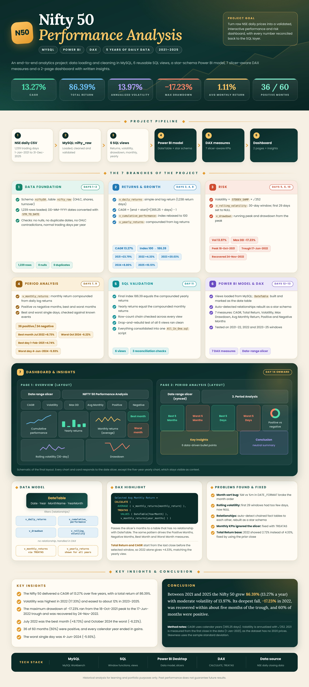

# Nifty 50 Performance Analysis

I wanted to know how the Nifty 50 actually behaved between 2021 and 2025, so I took the raw daily prices, cleaned and checked them in MySQL, built the calculations as SQL views, and put the results into a two-page Power BI dashboard.



## What the data says

- The index grew **13.27% a year** (CAGR), or **86.39%** in total over the five years.
- Annualised volatility was **13.97%**.
- The deepest fall was **-17.23%**. It started at the 18 Oct 2021 peak, bottomed on 17 Jun 2022, and was fully recovered by 24 Nov 2022.
- **36 of 60 months** were positive. The best month was July 2022 (+8.73%) and the worst was October 2024 (-6.22%).
- Every calendar year ended in gains: 2021 +23.79%, 2022 +4.33%, 2023 +20.03%, 2024 +8.80%, 2025 +10.51%.
- The worst single day was 4 Jun 2024 (-5.93%), the general election result day.

## How it's built

1. **Data:** daily open, high, low, close, shares traded and turnover for 1,239 trading days (1 Jan 2021 to 31 Dec 2025).
2. **MySQL:** loaded into a raw table, then checked for nulls, duplicate dates, impossible OHLC prices and odd trading-day counts.
3. **Six SQL views:** daily returns, cumulative performance, 30-day rolling volatility, drawdown, monthly returns and yearly returns.
4. **Power BI model:** a date table in the middle with the views connected to it (star schema).
5. **DAX:** seven measures (CAGR, total return, volatility, max drawdown, average monthly return, positive and negative months) that all respond to the date slicer.
6. **Dashboard:** page 1 for performance and risk, page 2 for best and worst months and days, plus written insights.

I checked each step against the one before it. For example, the final index value of 186.39 matches the compounded yearly returns, and the compounded monthly returns match the yearly ones.

## Things that went wrong along the way

- A `%M` instead of `%m` in a date format sorted my months alphabetically.
- The first 29 rolling-volatility windows had too little data, so they now return NULL instead of a misleading number.
- Power BI's auto-detected relationships chained my tables to each other. I rebuilt them as a proper star schema.
- The monthly KPIs ignored the date slicer until I rewrote them with `TREATAS`.
- Total Return showed 2.72% for 2022 instead of 4.33% because it started from the wrong base price. It now starts from the last close before the selected window.

## Repo layout

```
data/        nifty_master_clean.csv
sql/         all_in_one.sql (all six views in one script)
             step-by-step/ (the scripts in the order I wrote them)
powerbi/     Nifty50_Performance_Analysis_Dashboard.pbix
Summary_Image/ project overview graphic
```

## Running it yourself

1. In MySQL Workbench, run `sql/step-by-step/01_create_and_load.sql`. Change the file path in the `load data local infile` line to where you saved the CSV, and make sure `local_infile` is enabled.
2. Run `sql/all_in_one.sql` to create the six views, or run the step-by-step scripts in order.
3. Open the `.pbix` file in Power BI Desktop and point the MySQL connection at your own server.

## Notes

- Tools: MySQL, Power BI Desktop, DAX.
- `sql/step-by-step/10_return_distribution.sql` (skewness and kurtosis of daily returns) isn't used in the dashboard. Thought to use in further future analysis.
- Dates in the CSV are DD-MM-YYYY, which is why the load script converts them with `STR_TO_DATE`.
- This is a learning project. It is a historical analysis, not investment advice, and past performance doesn't guarantee future results.
